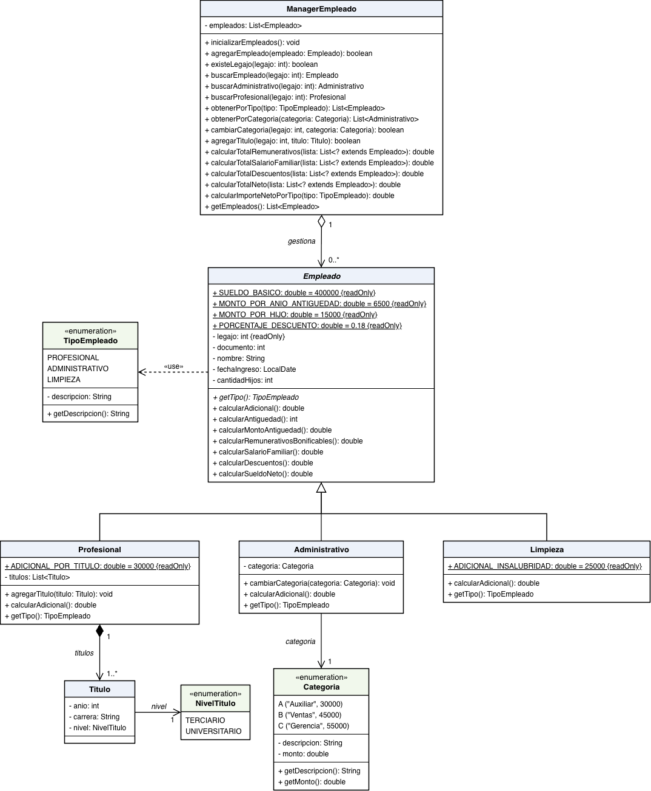

# Programación Orientada a Objetos – Grupo 8

Analista Programador Universitario – Extensión Áulica San Pedro

| Trabajo práctico | Tema |
|---|---|
| [TP6](#trabajo-práctico-6--clases-y-relaciones) | Clases y relaciones: playa de estacionamiento y sueldos de empleados |
| [TP8](#trabajo-práctico-8--excepciones-y-pruebas-unitarias) | Excepciones y pruebas unitarias sobre el ejercicio 2 del TP6 |

## Integrantes

- VITO BERNARDO BERNAL
- DANIEL ORLANDO VARGAS RUIZ
- SERGIO SEBASTIÁN ORTEGA

## Estructura del proyecto

| Contenido | Ubicación |
|---|---|
| Ejercicio 1 – Estacionamiento | `ar.edu.unju.fi.poo.estacionamiento` · `MainEstacionamiento` |
| Ejercicio 2 – Empleados | `ar.edu.unju.fi.poo.empleados` · `MainEmpleados` |
| Excepción (TP8) | `ar.edu.unju.fi.poo.empleados.exception.EmpleadoException` |
| Pruebas unitarias (TP8) | `src/test/java/ar/edu/unju/fi/poo/EmpleadoTest` |

Los `Main` se ejecutan con *Run As → Java Application* y los tests con *Run As → JUnit Test*. Requiere JDK 25.

---

## Trabajo Práctico 6 – Clases y Relaciones

### Ejercicio 1 – Playa de estacionamiento

#### Preguntas

**a. ¿Cuántos atributos y operaciones tienen PorHora y Mensual?**
`PorHora` declara 2 atributos (`cupon`, `valorHora`) y `Mensual` 1 (`cliente`); ninguna declara operaciones propias. Las dos heredan de `RegistroIngresoSalida` 5 atributos y 2 operaciones (`obtenerImporte()` y `cambiarEstado()`): en total, `PorHora` tiene 7 atributos y `Mensual` 6, con 2 operaciones cada una. No se cuentan constructores, getters ni setters.

**b. ¿Un ingreso por hora es un tipo de RegistroIngresoSalida?**
Sí. `PorHora` hereda de `RegistroIngresoSalida` (generalización): es una relación *es un*.

**c. ¿Un cliente es un tipo de RegistroIngresoSalida?**
No. `Cliente` se relaciona con `Mensual` por agregación: un registro mensual *tiene un* cliente.

**d. ¿Cuántas clases abstractas y métodos abstractos hay?**
Una clase (`RegistroIngresoSalida`) y un método (`obtenerImporte()`), ambos en cursiva en el diagrama.

**e. ¿Es necesario implementar obtenerImporte() en las subclases de RegistroIngresoSalida?**
Sí, porque es abstracto. `PorHora` calcula horas × valor hora menos el cupón, y `Mensual` devuelve 0.

**f. ¿Es necesario implementar registrarIngreso() en las subclases de Manager?**
No. `Manager` es concreta, no tiene subclases y el método no es abstracto.

**g. ¿Vehiculo es una subclase de RegistroIngresoSalida?**
No. Un registro *tiene un* vehículo (agregación); no hay herencia entre ellas.

#### Decisiones de implementación

- `Date` se implementó con `LocalDate` (fecha) y `LocalTime` (hora). El estado es un `String` con las constantes `INGRESADO` y `AFUERA`.
- Ingreso: se rechaza un vehículo que ya está dentro de la playa (`validarPatente`) y, si es por hora, el ingreso fuera de 08:00 a 21:00. Los clientes mensuales no tienen restricción de horario.
- Importe por hora: $1.000 por hora; toda hora empezada se cobra completa (mínimo 1 hora). El cupón se aplica solo si no está vencido. El importe mensual es $0.

#### Casos de prueba (`MainEstacionamiento`)

| Caso | Qué se prueba |
|---|---|
| a | Ingreso por hora sin cupón. |
| b | Ingresos con cupón vigente (10%) y vencido; salida simulando 3 horas para comparar importes. |
| c | Ingreso por hora a las 22:30, rechazado por horario. |
| d | Ingreso de un cliente mensual. |
| e | Búsqueda por ID mostrando el importe actual. |
| f | Búsqueda por ID y salida por hora: importe y estado AFUERA. |
| g | Búsqueda por ID y salida de un cliente mensual: $0 y estado AFUERA. |

### Ejercicio 2 – Sueldos de empleados

#### Historias de usuario

- **HU01 – Registrar empleado.** Como encargado de sueldos, quiero registrar un empleado (legajo, documento, nombre, fecha de ingreso, cantidad de hijos y tipo) para calcular su sueldo. *Criterios:* el legajo no se repite; los datos son obligatorios; el tipo es Profesional, Administrativo o Limpieza.
- **HU02 – Registrar títulos de un profesional.** Como encargado, quiero registrar los títulos de un profesional (año, carrera y nivel) para sumar su adicional. *Criterios:* al menos un título; nivel Universitario o Terciario; $30.000 por título.
- **HU03 – Asignar categoría a un administrativo.** Como encargado, quiero asignar una categoría a cada administrativo para sumar su monto al sueldo. *Criterios:* categoría obligatoria; A (Auxiliar) $30.000, B (Ventas) $45.000, C (Gerencia) $55.000.
- **HU04 – Adicional por insalubridad.** Como encargado, quiero sumar el adicional por insalubridad a los empleados de limpieza. *Criterios:* $25.000, solo para limpieza.
- **HU05 – Calcular antigüedad.** Como encargado, quiero calcular la antigüedad desde la fecha de ingreso para sumar $6.500 por año. *Criterios:* solo se cuentan años completos.
- **HU06 – Calcular salario familiar.** Como encargado, quiero pagar el salario familiar por hijo a cargo. *Criterios:* $15.000 por hijo; $0 si no tiene hijos.
- **HU07 – Calcular descuentos.** Como encargado, quiero calcular los descuentos del sueldo. *Criterios:* 18% de los remunerativos bonificables.
- **HU08 – Calcular sueldo neto.** Como encargado, quiero obtener el sueldo neto de cada empleado. *Criterios:* remunerativos = básico ($400.000) + adicional + antigüedad; neto = remunerativos + salario familiar − descuentos; cada adicional solo para su tipo.
- **HU09 – Consultar empleado por legajo.** Como encargado, quiero buscar un empleado por legajo para ver sus datos y su sueldo neto. *Criterios:* se muestra el detalle del sueldo; si no existe, se informa.
- **HU10 – Cambiar la categoría de un administrativo.** Como encargado, quiero cambiar la categoría de un administrativo para actualizar su sueldo. *Criterios:* se muestra el neto antes y después; si no es administrativo, no se modifica.
- **HU11 – Agregar un título a un profesional.** Como encargado, quiero agregar un título a un profesional para actualizar su adicional. *Criterios:* se muestra el neto antes y después; si no es profesional, se informa.
- **HU12 – Listar empleados de una categoría.** Como encargado, quiero ver los empleados de una categoría con sus totales. *Criterios:* se muestran remunerativos, salario familiar, descuentos y neto de cada uno, y los totales al final.
- **HU13 – Importe neto por tipo de empleado.** Como encargado, quiero el importe neto acumulado de un tipo de empleado elegido por mí. *Criterios:* el tipo se pide al usuario y se valida; se muestra el detalle y el total.

#### Diagrama de clases

- `Empleado` es abstracta; su único método abstracto es `getTipo()`.
- `calcularAdicional()` es un único método: en `Empleado` devuelve 0 y cada subclase lo redefine (títulos, categoría o insalubridad).
- El cálculo del sueldo (remunerativos, salario familiar, descuentos y neto) se implementa una sola vez en `Empleado`.
- `Categoria` es un enumerado con descripción y monto. `Profesional – Titulo` es una composición 1..*.
- `ManagerEmpleado` concentra las reglas de negocio y las operaciones; `inicializarEmpleados()` carga 6 empleados, dos de cada tipo.

#### Casos de prueba (`MainEmpleados`)

| Caso | Qué se prueba |
|---|---|
| a | Agregar empleados de distintos tipos y rechazar un legajo repetido. |
| b | Buscar por legajo y mostrar el detalle del sueldo neto; legajo inexistente. |
| c | Cambiar la categoría de un administrativo (B → C), con el neto antes y después. |
| d | Agregar un título a un profesional, con el neto antes y después. |
| e | Empleados de la categoría elegida por el usuario, con totales. |
| f | Importe neto acumulado del tipo elegido por el usuario. |

---

## Trabajo Práctico 8 – Excepciones y Pruebas Unitarias

Se aplica sobre el ejercicio 2 del TP6.

### 1. Excepción personalizada

`EmpleadoException` extiende de `Exception` (es *checked*): los constructores del modelo y las operaciones del Manager la declaran con `throws`, y `MainEmpleados` la captura y muestra el mensaje.

### 2. Validaciones

| Validación | Dónde se controla |
|---|---|
| a. El documento no puede repetirse | `ManagerEmpleado.agregarEmpleado()` |
| b. Legajo con formato `NNNN-AA` | `Empleado` valida el formato; `ManagerEmpleado.generarLegajo()` lo genera |
| c. Fecha de ingreso menor o igual a hoy | `Empleado` |
| d. Cantidad de hijos entre 0 y 5 | `Empleado` |
| e. Profesional con al menos un título (Universitario/Terciario) | `Profesional` y `Titulo` |

Todas lanzan `EmpleadoException` con un mensaje que explica el error. `MainEmpleados` incluye una sección que muestra cada validación rechazada.

**Cambios respecto del TP6:**
- El legajo pasó de `int` a `String`. Se genera con 4 dígitos al azar y los dos últimos del año (por ejemplo `4821-26`), así que cambia en cada ejecución.
- Se usan 4 dígitos según el formato `NNNN-AA`. El ejemplo del enunciado (`23123-26`) tiene 5; esa duda queda registrada en un test desactivado.
- `ManagerEmpleado` suma `generarLegajo()`, `existeDocumento()` y `buscarPorDocumento()`. `agregarEmpleado()` ahora lanza la excepción en lugar de devolver `false`.
- El diagrama de clases corresponde al TP6 y no incluye estos cambios.

### 3. Pruebas unitarias

`EmpleadoTest` prueba cada operación de `ManagerEmpleado` y cada validación del punto 2. Resultado esperado: **28 tests correctos y 1 desactivado**.

| Requisito | Uso |
|---|---|
| `@BeforeEach` | `setUp()` crea el Manager, carga los 6 empleados y prepara dos empleados de prueba antes de cada test. |
| `@Test` | Una prueba por operación del Manager y por validación. |
| `@RepeatedTest` | `generarLegajo()` se ejecuta 10 veces: siempre cumple el formato y no se repite. |
| `@ParameterizedTest` + `@ValueSource` | Legajos mal formados, y cantidades de hijos válidas e inválidas. |
| `@Disabled` | Legajo de 5 dígitos, pendiente de confirmar con el profesor. |
| `assertEquals` | Cantidad de empleados, búsquedas y datos de los empleados. |
| `assertTrue` | `existeLegajo`, `existeDocumento`, formato del legajo y cambios de categoría o títulos. |
| `assertNull` | Búsquedas inexistentes y legajos que no corresponden al tipo buscado. |
| `assertThrows` | Documento o legajo repetido y cada validación del modelo. |
